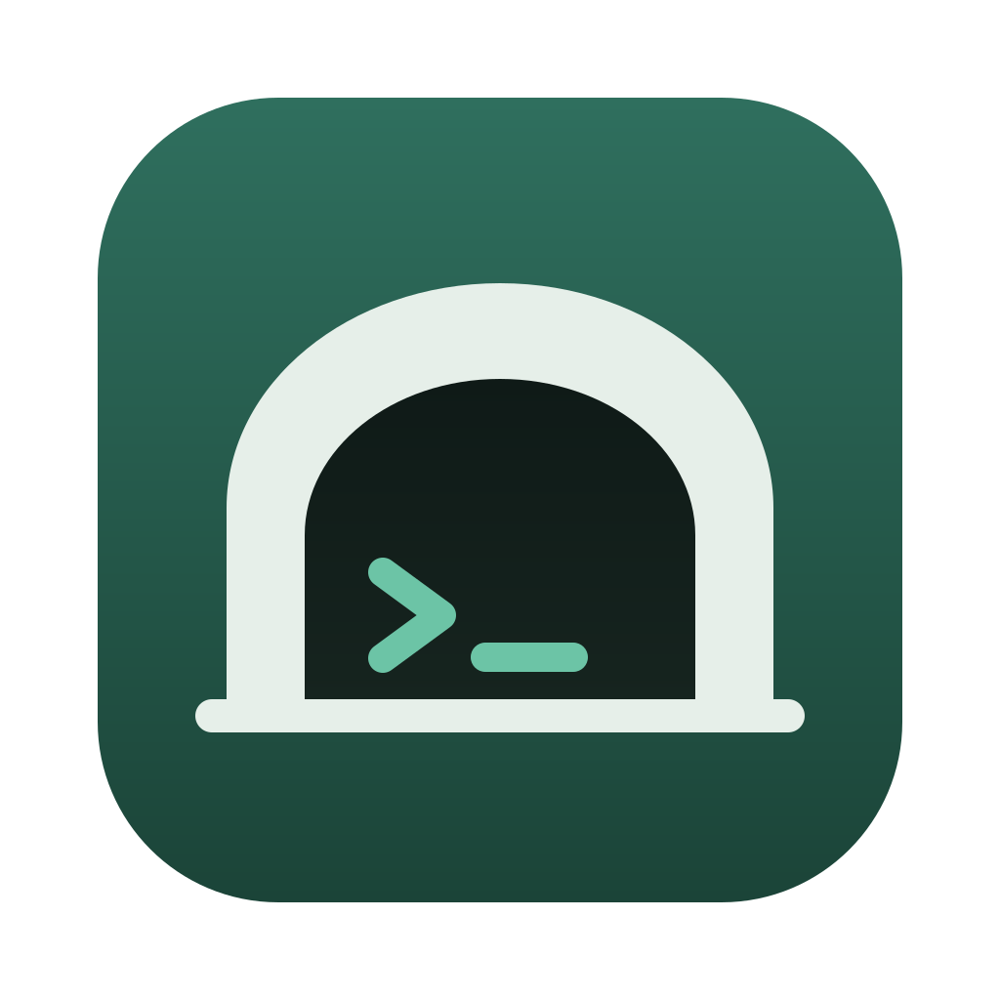
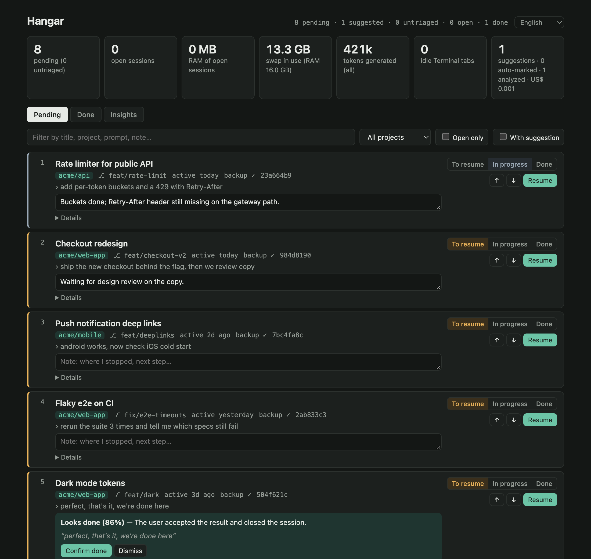
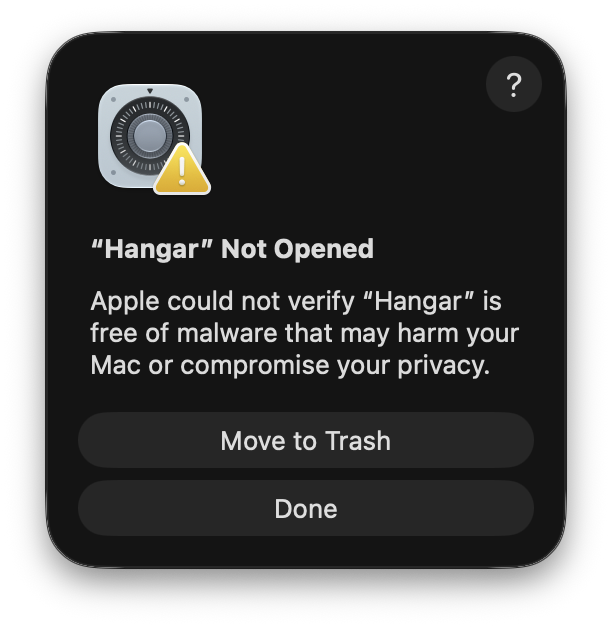
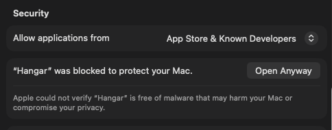
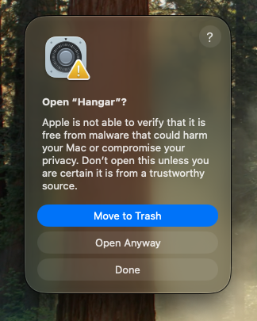
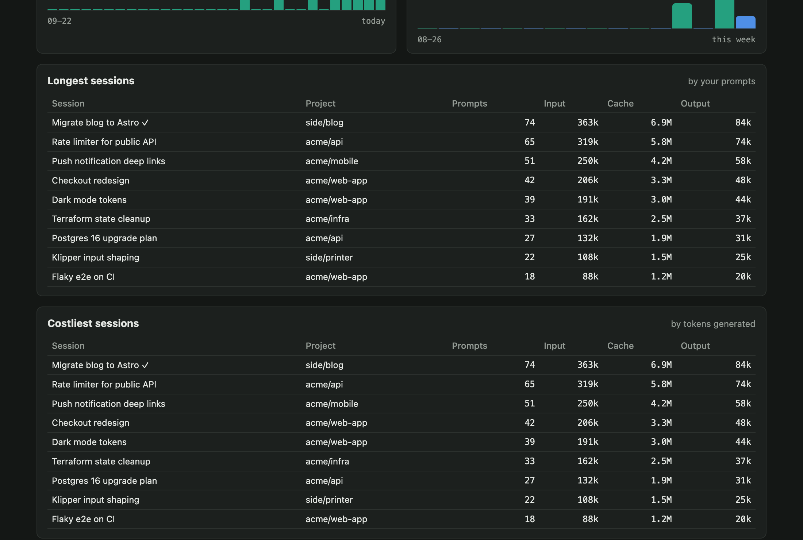

<h1> Hangar</h1>

Keep track of your Claude Code sessions, so you can close the ones you're not using without losing them.

Every session shows up on its own. You mark what to resume, set the order, write a note about where you stopped, and get back to any session with one click.



## Install

**1. Download.** Get **Hangar.zip** from the [latest release](../../releases/latest).

**2. Move to Applications.** Double-click the zip, then drag **Hangar.app** into your **Applications** folder.

**3. Open it the first time.** Hangar isn't from the App Store, so macOS stops the first launch with this message. Click **Done**.



Then open **System Settings → Privacy & Security**, scroll down to **Security**, and click **Open Anyway** next to the Hangar message.



macOS asks one last time. Click **Open Anyway** again and confirm with your password or Touch ID.



You only do this once. From then on Hangar opens like any other app.

> **Prefer the Terminal?** This does the same as step 3:
> ```sh
> xattr -dr com.apple.quarantine /Applications/Hangar.app
> ```

**4. Start it with your Mac (optional).** In the menu bar, choose **Hangar → Open at Login**.

The first time you click **Resume**, macOS asks whether Hangar may control Terminal. Click **Allow**, since that's how it opens your sessions.

### What you need

- A Mac with Apple Silicon, macOS 13 or later
- [Claude Code](https://docs.claude.com/en/docs/claude-code) installed (the `claude` command)

## What it does

- **Pending and Done lists** with every session in `~/.claude`: status (to resume, in progress, done), drag-to-reorder priority, notes, and which ones are open right now.
- **Resume, go to tab, close**: opens a closed session in a new Terminal tab, jumps to the tab of an open one, or closes it.
- **Transcript backup**: copies the transcripts of pending sessions to `~/Library/Application Support/Hangar/transcripts/`, so Claude Code's automatic cleanup can't delete them.
- **Done detection**: once a session has been closed for an hour, Claude Haiku reads its last messages. If it looks finished, you get a suggestion to confirm or dismiss. When it is at least 90% sure and can quote you saying so, it marks the session done by itself, and one click reopens it.
- **Insights**: how much RAM each open session holds, what's pending per project and for how long, prompts per day, longest and costliest sessions.
- **English and Portuguese**.



## Data and privacy

- Everything stays on your Mac: state and notes in `~/Library/Application Support/Hangar/`, logs in `~/Library/Logs/Hangar/`. Hangar only listens on `127.0.0.1`.
- Done detection sends the last ~24 messages of a closed session to Claude Haiku through your own `claude` CLI, billed to your Claude account (fractions of a cent per session).
- Claude Code deletes transcripts after 30 days by default. To keep them longer, set `"cleanupPeriodDays"` in `~/.claude/settings.json`.

## Limitations

- Terminal.app only (no iTerm2, Ghostty, etc.).

## Build from source

Needs Node.js ≥ 22.5 and the Xcode command line tools.

```sh
npm install
npm run build
open build/Hangar.app
```

`npm start` runs only the server; open the URL it prints.

## License

Source-available, not open source. You may use Hangar and modify it for personal use; you may not redistribute it or modified versions, paid or free. Contributions through pull requests are welcome. See [LICENSE](LICENSE).
